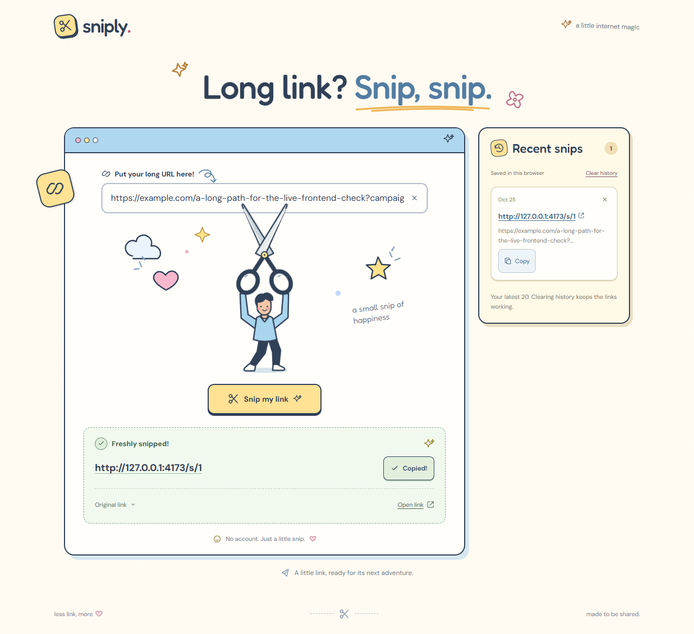

# Sniply — URL shortener

Sniply is a full stack assessment project built with Java 25, Spring Boot, React, Vite, and H2. It creates short links, redirects to the original destination, and keeps recent links in the browser. Optional Google sign-in adds account history, creation dates, and click counts. The responsive interface includes a scissors animation and reduced-motion support.

[Quick start](#quick-start) · [Run checks](#run-checks) · [Design decisions](#design-decisions) · [Documentation](#further-documentation)

## Preview



Captured locally with the guest flow. [View the mobile preview](docs/screenshots/result-mobile.png).

## Quick start

**The guest demo needs no Google credentials and no separately installed database.** H2 runs inside the backend, and Maven is provided through the wrapper.

Required:

- **JDK 25**, with `java` on PATH and `JAVA_HOME` pointing to that JDK.
- **Node.js 24 and npm** recommended. Node 20.19+ and 22.13+ are also supported within those major versions.
- Internet access on the first run to download dependencies.

Start from the repository root: the folder containing `backend/`, `frontend/`, and `docs/`.

**Terminal 1 — backend (macOS, Linux, or Git Bash):**

```bash
cd backend
bash ./mvnw spring-boot:run
```

**Windows PowerShell alternative for Terminal 1:**

```powershell
cd backend
.\mvnw.cmd spring-boot:run
```

**Terminal 2 — frontend (all platforms), starting from the repository root:**

```bash
cd frontend
npm ci
npm run dev
```

**Open http://localhost:5173.** The backend API runs on http://localhost:8080; its root has no landing page. Keep both terminals running. Stop them with Ctrl+C.

Links persist in `backend/data/` when the backend starts from `backend/`. Restart from the same directory to retain them. Local database files are excluded from Git.

## Try it

1. Paste a public URL, for example `https://en.wikipedia.org/wiki/URL_shortening`.
2. Click **Snip my link** or press Enter. The form completes a missing protocol as `https://`.
3. The textbox clears after success. Use **Copy** or **Open**, then reload the page to see the link in **Recent snips**.

Guest history keeps the latest 20 successful links in this browser. Clearing that list does not delete the backend mappings.

Google sign-in is disabled until configured. To assess account history and click counts, follow the separate [Google setup guide](docs/accounts.md); guest shortening works independently.

## Run checks

Run each command from the directory shown. Install frontend dependencies with `npm ci` first.

| Check | Directory | Command |
| --- | --- | --- |
| Backend tests, packaging, and process-restart check | `backend/` | `bash ./mvnw verify` (PowerShell: `.\mvnw.cmd verify`) |
| Frontend component and API-client tests | `frontend/` | `npm test` |
| Frontend production build | `frontend/` | `npm run build` |

Optional browser checks, from `frontend/`:

```bash
npm run build
npx playwright install chromium
npm run test:browser
```

On Linux, use `npx playwright install --with-deps chromium` if browser system libraries are missing. These browser checks use a stubbed API and start their own preview server; they do not require a backend.

Backend checks use isolated databases. The [testing guide](docs/testing.md) explains suite boundaries and optional real-backend browser checks.

[GitHub Actions](https://github.com/MeIsAmanda/url-shortener/actions/workflows/checks.yml) runs backend verification plus frontend tests/builds on Node 20 and 24, with Chromium checks on Node 24. A passing hosted run and dated local results are linked in the [verification record](docs/verification.md). CI checks the application; deployment is not configured.

## Design decisions

| Decision | Reason and tradeoff |
| --- | --- |
| File-based H2 and Flyway | Simple setup, persistent links, and explicit schema upgrades; the supplied deployment runs as one backend instance. |
| Snowflake IDs + Base62 | Distinct numeric allocation and compact encoding, with durable timestamp reservations for restarts; requires clock and worker-identity management. The epoch is fixed at 25 October 2026, midnight Singapore time. Codes remain structured and grow with elapsed time. |
| Optional Google login | Adds owner-scoped account history without passwords while preserving a credential-free guest demo; real sign-in requires an OAuth client. |
| Browser-local guest history | Keeps recent links without an account; it is specific to the browser and frontend origin. |

## Limitations and assessment status

The guest flow, account feature, responsive UI, automated checks, and CI are implemented. Manually verified on 27 October 2026: Google sign-in, account isolation, URL creation/redirects, history, and phone/keyboard checks. See the [verification record](docs/verification.md) for environment details and remaining checks.

- A manual fresh-machine walkthrough and specific mobile Safari/screen-reader coverage have not been recorded. Phone portrait/landscape and keyboard-only checks are included in the completed manual checklist.
- H2 and in-memory sessions are configured for a single backend instance. A restart preserves links and accounts but requires signing in again.
- Validation checks HTTP(S) syntax, domain/TLD rules, encoded characters, and a 2,048-character maximum; it does not check website availability or destination safety.
- Full short-URL length depends on the configured hostname; a localhost link can be longer than its destination.
- Click totals count successful GET redirect requests, including repeats and bots; they are not unique-visitor analytics.
- Security scans, load testing, and production deployment have not been completed. See the [project plan](docs/project-plan.md) for follow-up work.

## Further documentation

| Document | Contents |
| --- | --- |
| [Local development](docs/local-development.md) | Environment settings, API examples, persistence/backups, preview mode, and phone access |
| [Backend design](docs/backend-design.md) | Request flow, responsibilities, persistence, and migration history |
| [Snowflake IDs](docs/snowflake.md) | Epoch, worker configuration, reservations, and failure behavior |
| [Google accounts](docs/accounts.md) | OAuth setup, sessions, ownership, and click-count definitions |
| [URL validation](docs/url-validation.md) | Accepted input, Punycode, limits, and the bundled TLD snapshot |
| [Recent snips](docs/recent-snips.md) | Guest history, storage behavior, and responsive layout |
| [Testing guide](docs/testing.md) | Commands, test review order, boundaries, and manual checklist |
| [Verification record](docs/verification.md) | Dated results, hosted CI evidence, and unverified work |
| [AI usage and learning notes](docs/ai-usage.md) | AI-assisted workflow, work log, and learning notes |
| [Project plan](docs/project-plan.md) / [Prompt template](docs/prompt-template.md) | Assessment scope, follow-up work, and reusable change context |
