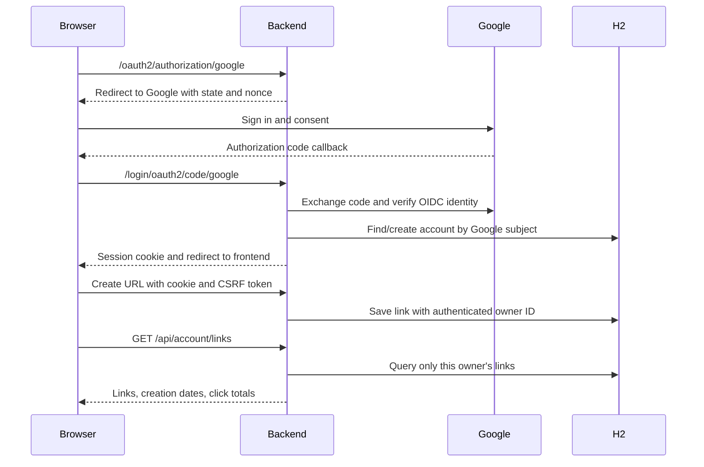

# Google accounts and link statistics

Google sign-in is optional. Guest shortening and browser Recent snips still work. The first successful Google sign-in creates a Sniply account automatically; subsequent sign-ins with the same Google subject use that account. No password is collected or stored.

Signed-in users see **My links** instead of Recent snips, with the destination, short URL, server creation date, and click total. Refresh reloads the latest numbers; returning focus to the page refreshes them too. Load older links requests another 20 records. Account history is stored in H2 and can be accessed from another device after signing into the same Google account.

Links created anonymously, including existing links and browser Recent snips, are not automatically assigned to an account. Knowing a public short URL is not proof of ownership. Signed-in creations are not added to guest localStorage. Signing out restores that browser's separate guest collection.

## Google Cloud setup

Google login is disabled by default until credentials are configured. A disabled sign-in button does not prevent guest shortening. Do not paste the client secret into chat, frontend code, Git, or screenshots.

1. Open [Google Cloud Console](https://console.cloud.google.com/) and choose or create a project.
2. Configure the OAuth consent screen/Google Auth Platform branding and audience. For initial external testing, add your Google account and any other testers as test users.
3. Create an **OAuth client ID** with application type **Web application**.
4. Add this exact authorized redirect URI for normal local development:

   ```text
   http://localhost:5173/login/oauth2/code/google
   ```

5. Copy the client ID and client secret into environment variables in the **backend terminal**. From `backend/`, PowerShell:

   ```powershell
   $env:GOOGLE_LOGIN_ENABLED = 'true'
   $env:GOOGLE_CLIENT_ID = '<your-web-client-id>'
   $env:GOOGLE_CLIENT_SECRET = '<your-client-secret>'
   $env:FRONTEND_BASE_URL = 'http://localhost:5173'
   $env:PUBLIC_BASE_URL = 'http://localhost:5173'
   .\mvnw.cmd spring-boot:run
   ```

6. In a second terminal, from `frontend/`, run `npm ci` if needed, then `npm run dev`. Open **http://localhost:5173**, choose Sign in with Google, and complete Google's consent/login screen. The app returns to this same origin.

The flow uses the server-side OAuth authorization-code/OpenID Connect client with scopes `openid`, `profile`, and `email`. It does not use a frontend Google access token or request access to Drive, Gmail, or other Google data. These backend variables do not use the `VITE_` prefix. Spring Boot does not automatically load a plain `.env` file in this setup; set the shell environment or configure the IDE's backend run environment.

The callback URL is derived from `FRONTEND_BASE_URL`. Scheme, hostname, port, and path must match the authorized URI in Google Cloud. `127.0.0.1` and `localhost` are different callback origins. For Vite preview, register `http://localhost:4173/login/oauth2/code/google` as another authorized URI and restart the backend with FRONTEND_BASE_URL/PUBLIC_BASE_URL set to that origin. Vite proxies `/api`, `/s/`, `/oauth2`, and `/login/oauth2` to the backend.

For an eventual hosted setup, register the real HTTPS callback, use the public frontend origin, set `SESSION_COOKIE_SECURE=true`, and route the same paths through the application backend. Review the consent-screen publication/verification requirements in Google Cloud before offering sign-in beyond test users. No hosted configuration or deployment is performed by this change.

## Authentication and ownership flow



Spring Security handles authorization state, nonce, ID-token verification, and session authentication. Google subject (`sub`), not an email address supplied by the browser, identifies an account. The backend chooses link ownership from the authenticated principal and ignores any client-supplied owner identity.

Session cookies are configured with `HttpOnly` and `SameSite=Lax`. The server-side session has a 30-minute idle timeout. `Secure` is controlled by `SESSION_COOKIE_SECURE`: the default is `false` for local HTTP development, and HTTPS hosting must set it to `true`. The cookie flags complement the existing CSRF protection. Authentication tokens and account history are not stored in localStorage. Signed-in creation and logout require a session CSRF token returned by GET `/api/auth/session`. Anonymous creation remains public and has no account authority. The signed-in UI sends `X-Sniply-Account: true` so an expired session cannot silently save a supposedly owned link as an anonymous link.

Sign out is POST `/api/auth/logout`; it invalidates the Sniply session, clears the cookie, and removes private UI. It does not sign the person out of Google globally. Sessions are currently in backend memory, so restarting the backend requires signing in again; persisted accounts/links/counters remain in H2. Multiple backend instances would need a tested shared database and session strategy.

## API

| Route | Behavior |
| --- | --- |
| GET /api/auth/session | Current user or null, Google sign-in availability, CSRF token; no-store |
| GET /oauth2/authorization/google | Starts Google authorization when enabled |
| GET /login/oauth2/code/google | Spring Security's configured callback |
| POST /api/auth/logout | CSRF-protected session logout; 204 |
| POST /api/urls | Existing contract; attaches current owner when authenticated; guest creation still works |
| GET /api/account/links | Authenticated owner's first 20 links, ordered by descending allocated ID |
| GET /api/account/links?before=ID | Next older page for that same owner |
| GET /s/{code} | Public 302 redirect; increments counter atomically; no-store |

History items contain `code`, `shortUrl`, `originalUrl`, `createdAt` (server ISO timestamp), and `clickCount`. A non-null `nextCursor` means another page is available. Cursors are decimal strings to preserve the full positive Java-long range in JavaScript. The count badge shows loaded records, with `+` when older records remain, rather than a database-wide total.

## What a click means

The counter increments once for each GET redirect resolved by the backend, including repeat visits, bots, scanners, and prefetch requests. HEAD requests and unknown codes do not increment it. It is not a count of distinct humans. Existing links start at zero when V4 is applied; historical visits cannot be reconstructed.

The database executes `click_count = click_count + 1` to avoid lost increments under concurrency. Redirects use Cache-Control: no-store so future visits reach the server rather than relying on a cached redirect. A visit that never reaches this backend cannot be counted. The counter write occurs before the redirect response; the extra write cost has not been load-tested. No per-visitor/IP event table or unique-visitor tracking was added.

## Migration and verification

Flyway V4 adds `user_accounts`, nullable `short_links.owner_id`, `click_count` defaulting to zero, an owner foreign key, and an owner/ID history index. It preserves all existing IDs, codes, destinations, timestamps, and sequence state. Before the first upgraded launch, stop the backend and back up `backend/data/`; source control does not back up this database. V1–V3 remain unchanged.

V5 changes new link ID allocation to Snowflake followed by Base62. Existing ownership, codes, dates, and counters remain unchanged. New IDs are above the legacy allocation floor, so the existing descending-ID history cursor continues to work; concurrent workers are only approximately time-ordered. The default local worker ID is zero. See [snowflake.md](snowflake.md) for the fixed epoch, worker configuration, restart behavior, and backup requirements.

Backend tests exercise account isolation, same-subject reuse, distinct simulated subjects with the same email, CSRF, logout, simulated session expiry, pagination, atomic concurrent counts, HEAD behavior, authorization redirect/invalid-state routing, and file-backed migration/reopen. Authenticated tests use Spring Security's test OIDC principals; browser account tests stub session/history responses. They do not perform a valid Google code exchange, test actual browser cookie handling, or wait for the idle timeout. See the [assertion boundaries](testing.md#what-the-assertions-currently-establish) for the exact pagination and callback checks.

Manually verified on 27 October 2026: real Google sign-in, owner isolation with two Google test accounts, exact redirects/count updates, and sign-out/restart/sign-in history restoration. Environment details are in the [verification record](verification.md#manual-verification--27-october-2026); the completed checklist is in [testing.md](testing.md#manual-review-checklist).

Automated account tests use simulated identities. OAuth credentials are required to enable sign-in in a new environment. Existing anonymous links remain unowned.

UI previews use explicitly mocked account/analytics data, not a real Google sign-in: [desktop account preview](screenshots/account-desktop.png) and [mobile account preview](screenshots/account-mobile.png).

References: [Google OpenID Connect setup](https://developers.google.com/identity/openid-connect/openid-connect), [Spring OAuth2 Login](https://docs.spring.io/spring-security/reference/servlet/oauth2/login/core.html), and [Spring CSRF protection](https://docs.spring.io/spring-security/reference/servlet/exploits/csrf.html).
